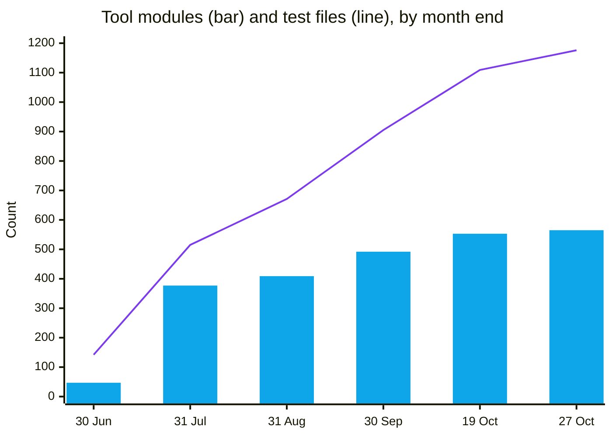

# NullCadre Research Library

**What informed the build of an AI-assisted platform for authorised penetration testing.**

---

This repository is the reading list and the method. It is published so that the research behind
NullCadre can be examined independently. It contains no implementation: nothing here is sufficient
to rebuild the platform.

> **The deterministic engine decides whether a weakness exists.** The hunter reasons about the
> evidence that engine produced and widens coverage. It never issues a verdict.

<table>
<tr><td width="50%" valign="top">

### 🧑‍💻 Human in the loop, not autonomous

The operator defines the scope, authorises it, launches every run and confirms any exploitation.
The software never decides on its own what to test, or whom to test it against.

</td><td width="50%" valign="top">

### 🔒 Local AI only

The hunter is the AI pass that takes the deterministic battery's findings as leads and deepens the
search. It runs on a model hosted inside the operator's estate, so no client data reaches a third
party: not the attack surface, not the findings, not the evidence, not the report text. There is no
hosted model anywhere in the loop.

</td></tr>
</table>

**Platform** [nullcadre.com](https://nullcadre.com) · **Owner** [HuzoSecurity Ltd](https://huzosecurity.com), Robert Huzo

---

## 📊 The work

Built between **11 June and 27 October 2026**: 138 days, 2,121 commits, roughly 365,000 lines of code.

| | | | |
|---|--:|---|--:|
| 🧩 **Reach a live target** | **312** | 📄 Analyse collected material only | 105 |
| 🧠 Reasoning-engine actions | 157 | ⚙️ Third-party tools driven | 79 |
| 📦 Tool modules in total | 565 | 🔌 Reachable from a real entry point | 563 |
| 🧾 Produce a security finding | 405 | 🧰 Utilities, oracles and helpers | 160 |
| 📐 Core code | 210,641 lines | 🧪 Test code | 154,211 lines |
| 📁 Test files | 1,176 | ✅ Tests passing | **12,501** |

**Each figure above states the question it answers, because no single number counts "capabilities"
honestly.** This page has published two wrong ones. It said 565, the whole tool tree, which counts
parsers and helpers as arsenal. It was corrected to 312, the modules that pass scope validation -
and that erases every detector which reads collected material rather than touching a target:
Active Directory, mobile packages, cloud artefacts, and the source-analysis work that produced
this project's published vulnerabilities.

So the figures are given as measurements rather than as a headline. 312 modules can reach a live
target. 405 produce a security finding. 105 produce one without contacting anything, because they
read what was already collected. The remainder are utilities, oracles and shared helpers, and some
of those are part of a capability without being one on their own - which is precisely why the
single number does not exist. Anyone is free to disagree with where the line falls; they cannot be
misled about where it was drawn.

The same audit reports what the capability figure is worth: 563 of the 565 modules are reachable
from a real entry point, none fails to import, and none is without a test. Two are not reachable,
and they are counted here because a capability nobody can invoke is not one.

> [!IMPORTANT]
> **Measured false-positive rate: 0 to 5 per cent**, with one authenticated engagement producing 63
> findings and zero false positives. **222 detectors** are pinned in the test suite as provably
> silent on a benign input. Reaching that took longer than reaching coverage.

Test code is 73% of the volume of the code it protects. That ratio is deliberate: in this domain a
test that proves a detector behaves is part of the deliverable, not overhead.

### How it grew

Counted from the commit tree at each month end, not estimated.

| Month end | Tool modules | Test files | Commits | Tests per module |
|---|--:|--:|--:|--:|
| 30 June 2026 | 47 | 142 | 199 | 3.0 |
| 31 July 2026 | 377 | 515 | 826 | 1.4 |
| 31 August 2026 | 409 | 671 | 1,029 | 1.6 |
| 30 September 2026 | 492 | 905 | 1,580 | 1.8 |
| 19 October 2026 | 553 | 1,109 | 2,023 | 2.0 |
| **27 October 2026** | **565** | **1,176** | **2,121** | **2.1** |

The July step is the month the detector battery was built. What the later months add is not breadth but
proof: between September and October the module count rose by 15 per cent while the test files rose by
30 per cent, which is the shape intended. The last column is the one worth watching, because a platform
that adds detectors faster than it can show them behaving is accumulating a liability, not coverage.

The final week is the clearest example of that shape: 12 modules added against 67 test files. Almost
none of that week's work was new coverage. It was finding that existing coverage had been reporting
results it had not earned, and the tests are the record of each one being disproved.

### Where the reading went

| Collection | | Items | Share |
|---|---|--:|--:|
| AI and cybersecurity | `████████████████████████████` | **97** | 39% |
| Practitioner guides | `██████████████` | **47** | 19% |
| Academic survey bundle | `██████████` | **35** | 14% |
| Bug-bounty practice | `██████` | **22** | 9% |
| API authorisation | `█████` | **16** | 6% |
| LLM security | `███` | **9** | 4% |
| Assessment practice | `█` | **4** | 2% |
| LLM-assisted triage | `█` | **4** | 2% |
| Automation | `█` | **3** | 1% |
| Platform ecosystem research | `█` | **3** | 1% |
| Certification | `█` | **2** | 1% |
| Hardening | `█` | **2** | 1% |
| Authorisation taxonomy and reach | `█` | **2** | 1% |
| Supply-chain advisory corpus | `█` | **1** | 0% |
| **Total** | | **247** | |

The weighting is deliberate. Two thirds of the reading sits in AI-and-security and practitioner method,
because the question this platform exists to answer is not which weaknesses exist but which of them a
machine can be trusted to judge. The smallest collections are the most recent: they are where the work
is now.

Every figure above was counted from the source tree at <b>v2.746.684</b> on 27 October 2026, by a
script that measures them rather than by hand, so the three repositories describing this platform cannot
drift apart again. Two figures are produced by executing the code rather than reading it, because the two
disagree: the action catalogue holds 157 entries and a regular expression over the same file counts 165.
Three figures published earlier were withdrawn for having no reproducible method: 178 battery phases, 37
engagement profiles where the registry holds 6, and a tool catalogue of 70, replaced here by the count of
third-party tools actually listed. The source counts are derived from the tables in SOURCES.md, so they can
be checked against the page itself.

## 📚 The library

| | Document | Contents |
|:--:|---|---|
| 📖 | **[SOURCES.md](SOURCES.md)** | 247 books, papers and guides · 637 external domains · 17 specifications read in the original |
| 🧭 | **[METHOD.md](METHOD.md)** | How the work was done: the rules, and the failure each one prevents |
| 🧰 | **[TOOLS.md](TOOLS.md)** | The 312 offensive capabilities, and the open-source tools they drive |
| 🎯 | **[COVERAGE.md](COVERAGE.md)** | What the platform tests for, by weakness class |

## 🚧 Scope of this repository

This repository publishes the research and the method. The implementation stays with its owner.

That division is deliberate and complete: what is here is what a reader needs to judge the work,
and what is not here is what someone would need to copy it. The platform cannot be rebuilt from
this repository, and it is not intended to be.

<b>What stays closed, and why</b>

 

**🔧 Techniques and tactics.** The weakness classes studied are named, because that is what
establishes coverage. The way the platform tests them is not described, and neither are payload
logic, bypass families or verdict rules.

**💾 The platform's own code.** Its 565 tool modules are counted, never named or described: no source,
no logic, no thresholds, no sequencing, no decision rules.

**🔗 Orchestration.** The 79 third-party tools are listed because they are public software anyone
can install. Which drives which, in what order, under what conditions, and how their output becomes
a verdict is where the value sits, and is not described.

**🤐 Client work.** No programme names, hosts, target identifiers, findings or evidence appear.
Disclosing a finding without permission would breach the programmes under which the work was
authorised, and that obligation is treated as absolute.

## ⚖️ Licence

The documents in this repository are published for reference. The platform they describe is not
included and is not open source.

Authorised testing only.

